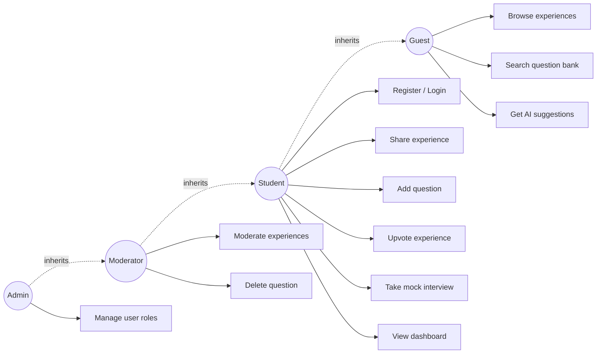

# Software Requirements Specification (SRS) — InterviewHub

Version 1.0 · Based on IEEE 830 structure

## 1. Introduction
### 1.1 Purpose
Specifies the functional, non-functional and security requirements of InterviewHub (Project 18). Every requirement has an ID that is traced to design elements and test cases in [02_Validation_Spec.md](02_Validation_Spec.md).

### 1.2 Scope
A web platform for crowdsourced interview experiences, a shared question bank with AI suggestions, and timed mock interviews with performance tracking. Out of scope: video/audio interviews, payments, mobile apps.

### 1.3 Definitions
| Term | Meaning |
|------|---------|
| Experience | A student's account of an interview process at a company for a role |
| Question bank | The shared, de-duplicated set of interview questions |
| Session | One timed mock interview containing N questions |
| Weak topic | A topic whose average practice score is below 60 |
| Moderator | User who approves or rejects experiences and deletes questions |

## 2. Overall description
### 2.1 User classes
| Actor | Description |
|-------|-------------|
| Guest | Unauthenticated visitor; can browse approved experiences, questions and suggestions |
| Student | Registered user; posts experiences/questions, votes, practises, sees dashboard |
| Moderator | Student permissions + moderation queue + delete questions |
| Admin | Moderator permissions + manage user roles and activation |

### 2.2 Operating environment
Any modern browser (Chrome, Firefox, Edge). Server: Linux container, Python 3.12.

### 2.3 Constraints & assumptions
- Must follow Agile methodology with GitHub for backlog, PRs and reviews.
- CI/CD, code review and security validation are mandatory.
- Content is user-generated; moderation is required to keep quality.

## 3. Use cases

### UC5 — Share experience (main flow)
1. Student opens "Share your experience" and fills company, role, year, mode, outcome, difficulty, summary, rounds and asked questions.
2. System validates input (FR-2.2).
3. System creates/links the company, stores the experience as *pending* (or *approved* for moderators).
4. System adds each asked question to the bank, merging duplicates (FR-3.3).
5. System confirms submission. **Alternate:** validation fails → field errors shown, nothing stored.

### UC8 — Take mock interview (main flow)
1. Student chooses role, company, topic, number of questions and time limit.
2. System picks questions: unseen first, ranked by the suggestion engine with weak-topic boost (FR-4.1).
3. Student answers each question; system scores it immediately and shows feedback (FR-4.3).
4. Student clicks Finish or the timer ends; system computes total score and reveals key points (FR-4.4, FR-4.5).
5. Dashboard updates (FR-4.6). **Alternate:** no question matches → error message, no session created.

## 4. Functional requirements
Priority: **H** = must, **M** = should, **L** = could.

### M1 — Authentication & User Management
| ID | Requirement | Pri |
|----|-------------|-----|
| FR-1.1 | Users register with name, email, password; optional college, graduation year, target role. Email is unique (case-insensitive). | H |
| FR-1.2 | Users log in with email + password and receive a JWT valid for 120 minutes (configurable). | H |
| FR-1.3 | The first registered account becomes admin; others are students. | M |
| FR-1.4 | Authenticated users can view and update their profile. | H |
| FR-1.5 | Users can change their password after confirming the old one. | M |
| FR-1.6 | Admins can list users, change roles (student/moderator/admin) and activate/deactivate accounts; admins cannot change or deactivate themselves. | M |
| FR-1.7 | Deactivated users cannot log in and existing tokens stop working. | H |

### M2 — Interview Experiences & Companies
| ID | Requirement | Pri |
|----|-------------|-----|
| FR-2.1 | Students post an experience with company, role, year, mode, outcome, difficulty (1–5), summary (≥ 30 chars), tips, rounds (≤ 12), asked questions (≤ 30) and an anonymous flag. | H |
| FR-2.2 | Invalid outcome, mode, difficulty, year or short summary is rejected with 422. | H |
| FR-2.3 | Student posts are *pending* until a moderator approves; moderator/admin posts are auto-approved. Pending/rejected posts are visible only to the author and moderators. | H |
| FR-2.4 | Anyone can browse approved experiences filtered by company, role, outcome, year and free text, sorted by recent or most upvoted, paginated. | H |
| FR-2.5 | Logged-in users can toggle an upvote on others' experiences (one vote per user; no self-votes). | M |
| FR-2.6 | Authors can edit/delete their own experiences; moderators can delete any. | M |
| FR-2.7 | Company insights show experience count, selection rate (selected / decided), average difficulty, top 3 roles and question count. | M |
| FR-2.8 | Company names are normalised (slug) so "Goldman Sachs" and " goldman SACHS " are the same company. | M |
| FR-2.9 | Questions listed in an experience are added to the question bank linked to that experience. | H |

### M3 — Question Bank & AI Suggestions
| ID | Requirement | Pri |
|----|-------------|-----|
| FR-3.1 | Logged-in users add questions with text, topic (fixed list), difficulty (easy/medium/hard), optional company, role, tags and key-point answer. | H |
| FR-3.2 | Anyone can search questions by text/tag, topic, difficulty, company and role with pagination; results ordered by popularity. | H |
| FR-3.3 | A new question with text similarity ≥ 0.85 to an existing one (same or no company) is merged: `times_asked` is incremented instead of creating a duplicate. | H |
| FR-3.4 | The suggestion endpoint ranks questions using text similarity, company, role, topic, popularity and weak-topic signals, returning a score in [0, 1] and a human-readable reason. | H |
| FR-3.5 | When a topic filter is given, suggestions contain only that topic. | M |
| FR-3.6 | Authors and moderators can edit a question; only moderators can delete. | M |
| FR-3.7 | The suggestion engine is behind a provider interface so an LLM-based provider can replace it without changing callers. | L |

### M4 — Mock Interview & Performance Tracking
| ID | Requirement | Pri |
|----|-------------|-----|
| FR-4.1 | Students start a session with optional role, company, topic, 1–15 questions and a 5–180 minute limit. Questions not yet answered by the user are preferred; weak topics are boosted when enabled. | H |
| FR-4.2 | Key-point answers are hidden while a session is in progress. | H |
| FR-4.3 | Each submitted answer is scored automatically (keyword coverage + length), combined with optional self-rating, and returned with feedback listing covered and missed points. | H |
| FR-4.4 | Finishing a session computes the total as the mean item score (unanswered = 0) and reveals key points. | H |
| FR-4.5 | A session past its deadline becomes *expired* automatically; closed sessions reject answers. | H |
| FR-4.6 | The dashboard shows sessions completed, questions answered, average/best score, practice minutes, day streak, per-topic averages, weak (< 60) and strong (≥ 75) topics, last-10 trend and improvement. | H |
| FR-4.7 | Users can list their past sessions and review any of them. Users cannot see other users' sessions. | M |

## 5. Non-functional requirements (measurable)
| ID | Category | Requirement | How measured |
|----|----------|-------------|--------------|
| NFR-1 | Performance | 95% of API calls respond in < 300 ms with 1,000 questions on a 2-vCPU machine | Locust/pytest timing (VS §5) |
| NFR-2 | Performance | Suggestion ranking over 1,000 questions completes in < 200 ms | Benchmark test |
| NFR-3 | Reliability | Unit test branch coverage ≥ 85% overall, ≥ 90% per module | pytest-cov in CI |
| NFR-4 | Usability | A new user can start a mock interview within 3 clicks after login | Usability walkthrough |
| NFR-5 | Maintainability | Each module is self-contained (models, schemas, service, router); flake8 clean | CI lint stage |
| NFR-6 | Portability | Runs with one command via Docker | `docker compose up` |
| NFR-7 | Availability | Container exposes a health check at `/api/health` | Docker HEALTHCHECK |
| NFR-8 | Scalability | Database swappable via `DATABASE_URL` without code changes | Config review |

## 6. Security requirements
| ID | Requirement |
|----|-------------|
| SR-1 | Passwords stored only as bcrypt hashes; never returned by any API. |
| SR-2 | Passwords must be 8–128 characters with at least one letter and one digit. |
| SR-3 | Protected endpoints require a valid, unexpired, correctly signed JWT. |
| SR-4 | Login errors do not reveal whether the email exists (no user enumeration). |
| SR-5 | Role checks enforced server-side for moderation and admin endpoints. |
| SR-6 | All input validated by schema (types, lengths, enums); ORM parameterised queries prevent SQL injection. |
| SR-7 | All user content is HTML-escaped in the frontend (XSS protection); security headers `X-Content-Type-Options`, `X-Frame-Options`, `Referrer-Policy` are set. |
| SR-8 | Container runs as a non-root user; secrets come from environment variables, not code. |
| SR-9 | Users can only access their own practice sessions (object-level authorisation). |
| SR-10 | Static security scan (Bandit) and dependency audit (pip-audit) run in CI. |

## 7. External interfaces
- **REST API** under `/api/*`, JSON, documented automatically at `/docs` (OpenAPI).
- **UI** single-page app served at `/`.
