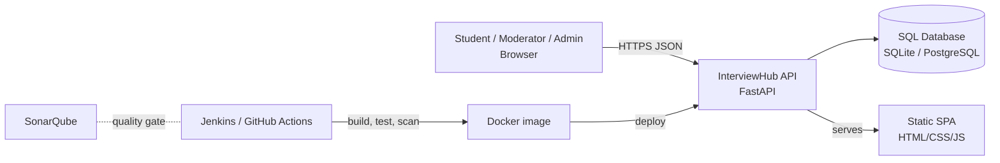
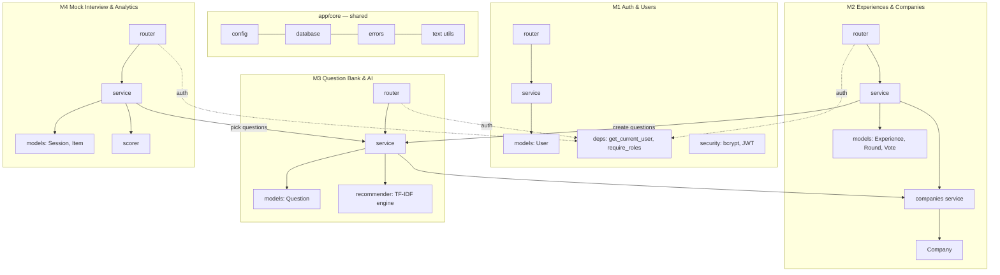
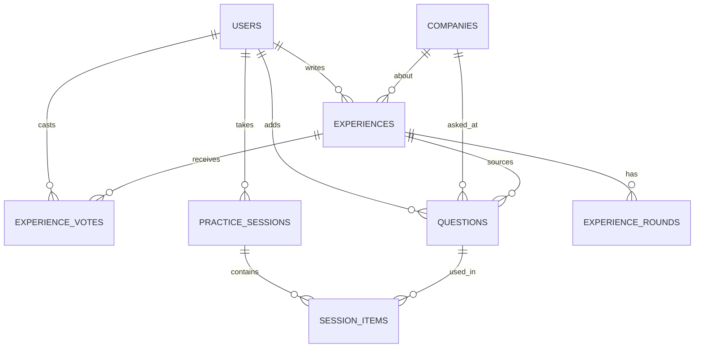
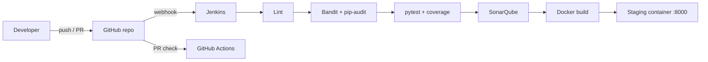

# High-Level Architecture Document — InterviewHub

## 1. Architectural style
A **modular monolith** with a **layered architecture** inside each module:

```
Router (HTTP, FastAPI)  →  Service (business rules)  →  Model (SQLAlchemy ORM)  →  Database
          ↑ Schemas (Pydantic contracts validate every request/response)
```

Why a modular monolith and not microservices: a 4-person team, one database, and a one-semester timeline. Module boundaries are still strict (each module exposes a small service API), so a module could be split into a service later.

## 2. System context


## 3. Module decomposition


### Dependency rules
- Modules depend on **core** and on other modules only through their `service` functions or `auth.deps`.
- No circular dependencies: `auth ← companies ← questions ← experiences`, `questions ← practice`.
- Services raise domain errors (`app/core/errors.py`); one handler maps them to HTTP status codes, so services can be unit tested without HTTP.

## 4. Interface definitions between modules (API stability contract)
| Provider | Function | Consumer | Purpose |
|----------|----------|----------|---------|
| M1 | `get_current_user`, `get_optional_user`, `require_roles(*roles)` | M2, M3, M4 routers | Authentication & authorisation |
| M2 (companies) | `get_or_create(db, name)`, `find_by_name`, `slugify` | M2, M3 | Shared company catalogue |
| M3 | `create(db, QuestionCreate, author, source_experience_id, commit)` → `(Question, created)` | M2 | Feed asked questions into bank |
| M3 | `suggest(db, Query)` → `[(Question, score, reason)]` | M4 | Select interview questions |
| M3 | `recommender.SuggestionProvider` protocol | Future LLM provider | Extensibility |
| M4 | `analytics(db, user)` → `Analytics` | M4 `start()` | Weak-topic feedback loop |

These signatures are frozen at the end of Sprint 1, Week 1; changes require a PR reviewed by both affected owners.

## 5. Data architecture


## 6. UI/UX design
- Single-page app with hash routing; top navigation: **Experiences · Question Bank · Mock Interview · Dashboard · (Moderation)**.
- Design principles: one primary action per screen (blue button), card layout, colour-coded pills (green = selected/easy, amber = pending/medium, red = rejected/hard), toasts for feedback.
- Accessibility: semantic HTML, labelled inputs, sufficient contrast, keyboard-submittable forms, SVG chart has an `aria-label`.
- Flow to start practising after login: Mock Interview → Start interview (2 clicks, meets NFR-4).

| Screen | Purpose | Owner |
|--------|---------|-------|
| Login / Register / Profile | Account management | M1 |
| Experiences list, Share form, Company insights, Moderation | Crowdsourced experiences | M2 |
| Question bank, AI suggestions, Add question | Question bank | M3 |
| Mock interview setup, live session, review, Dashboard | Practice & analytics | M4 |

## 7. Deployment architecture

The container runs as a non-root user, stores the SQLite file on a volume (`/data`) and exposes `/api/health` for health checks.

## 8. Cross-cutting concerns
| Concern | Approach |
|---------|----------|
| Configuration | `app/core/config.py`, environment variables only |
| Error handling | Domain exceptions → single JSON error handler |
| Security | JWT, bcrypt, role checks, object-level ownership checks, input schemas, output escaping, security headers |
| Logging | Uvicorn access logs; Jenkins archives test, coverage and Bandit reports |
| Testability | Dependency-injected DB session; pure functions for scoring and ranking |
