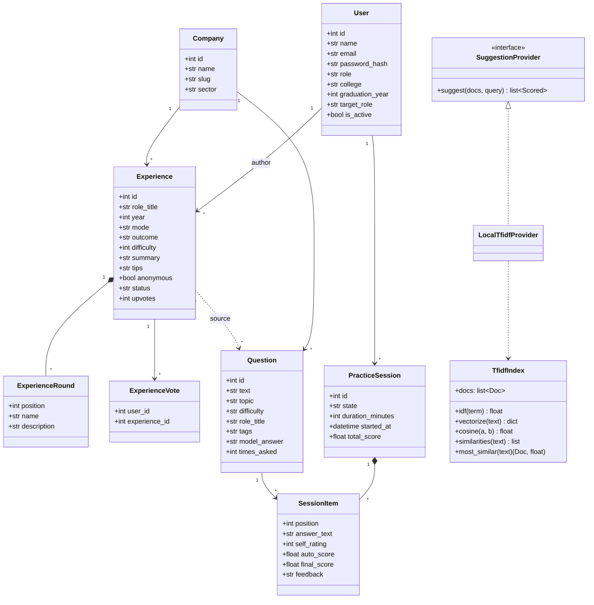
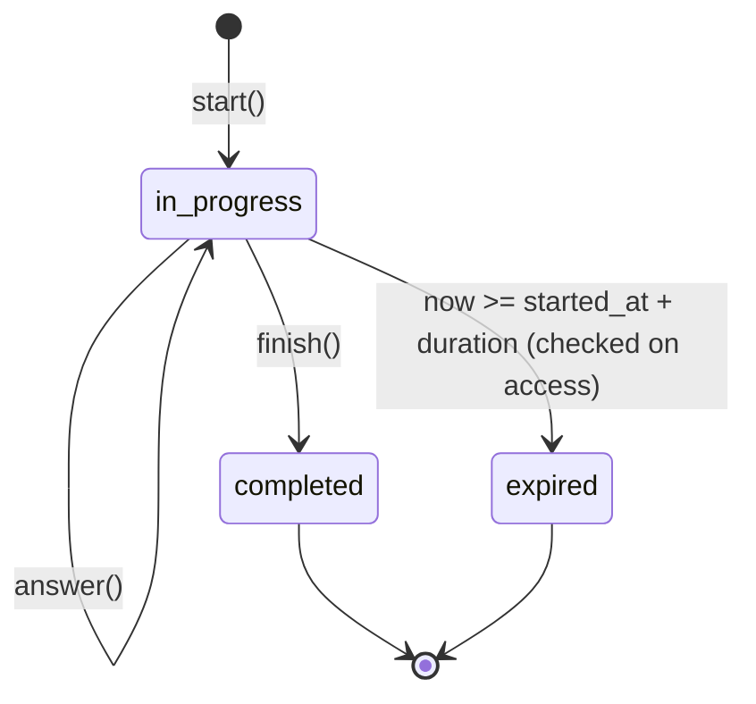
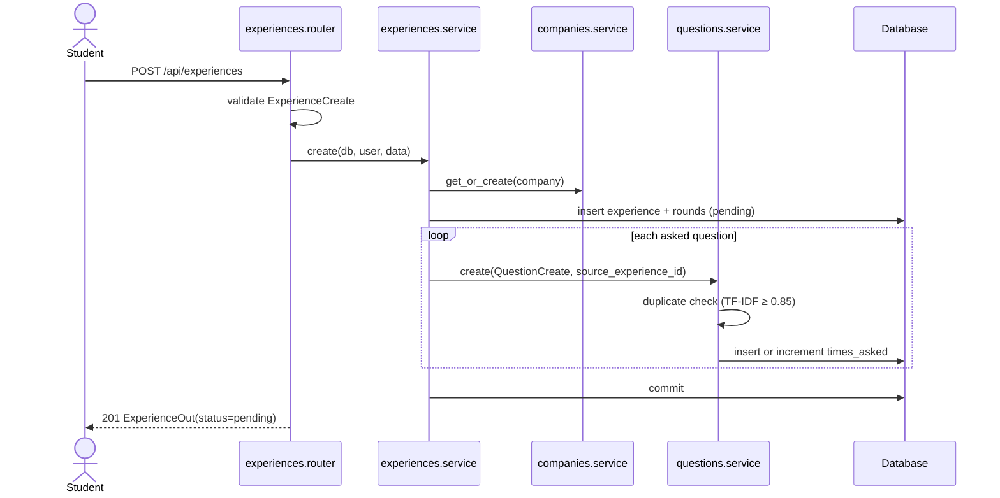
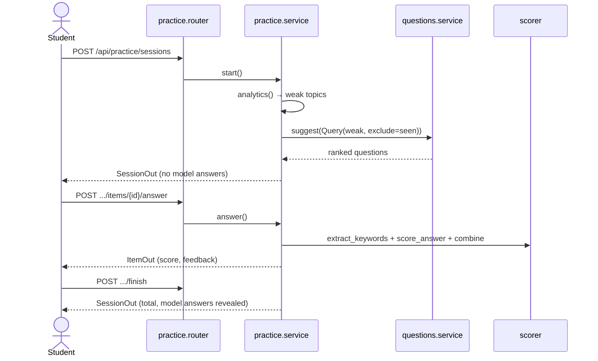

# Software Design Document (Low-Level Design) — InterviewHub

## 1. Package structure
```
app/
  core/            config.py, database.py, errors.py, text.py          (shared)
  modules/
    auth/          models, schemas, security, service, deps, router      (M1)
    companies/     models, service                                       (M2)
    experiences/   models, schemas, service, router                      (M2)
    questions/     models, schemas, recommender, service, router         (M3)
    practice/      models, schemas, scorer, service, router              (M4)
  main.py          app factory, router wiring, error handler, headers
frontend/          index.html, css/, js/{api,auth,experiences,questions,practice,app}.js
tests/             conftest.py + one test file per module
scripts/seed.py    demo data
```

## 2. Class diagram


## 3. Key algorithms

### 3.1 Suggestion ranking (M3) — `recommender.recommend`
1. Drop excluded IDs (questions the user already answered).
2. Build a TF-IDF index over candidates. Document terms = text tokens + tags×2 + topic×2. IDF is smoothed: `ln((1+N)/(1+df)) + 1`. TF is `1 + ln(count)`. Vectors are L2-normalised.
3. For each candidate compute signals in [0,1]: cosine similarity, company match, role match (exact = 1, else Jaccard of role tokens), topic match, popularity (`times_asked / max`), weak topic.
4. `score = 0.55·sim + 0.15·company + 0.10·role + 0.10·topic + 0.05·popularity + 0.05·weak` (weights sum to 1, so score ∈ [0,1]).
5. If a topic filter is given, drop non-matching topics. Sort by score desc, then id; return top *limit* with an explanation string.

### 3.2 Duplicate detection (M3)
A text-only TF-IDF index over existing questions (same company or no company). If the best cosine similarity ≥ **0.85**, increment `times_asked` of the match and return it with `X-Duplicate-Merged: true`.

### 3.3 Answer scoring (M4) — `scorer`
1. **Keywords:** tags first, then the most frequent tokens of the model answer (or of the question if no model answer), de-duplicated by stem, max 8.
2. **Coverage:** fraction of keywords whose stem appears in the answer (simple suffix stemmer: `threads→thread`, `processes→process`).
3. **Length factor:** `min(1, words / 40)`.
4. `auto = 100 × (0.75·coverage + 0.25·length)`; with self-rating `final = 0.7·auto + 0.3·(rating×20)`.
5. Feedback: verdict band (≥80 strong, ≥50 gaps, else needs work) + covered + missed + "elaborate" hint.

### 3.4 Session state machine (M4)


### 3.5 Streak (M4)
Set of session dates; start from today (or yesterday if no session today) and count consecutive days backwards.

## 4. Sequence diagrams

### 4.1 Share experience (M2 → M3)


### 4.2 Mock interview (M4 → M3)


## 5. REST API specification
| Method | Path | Auth | Module | Description |
|--------|------|------|--------|-------------|
| POST | `/api/auth/register` | — | M1 | Create account |
| POST | `/api/auth/login` | — | M1 | Get JWT + user |
| GET/PATCH | `/api/users/me` | user | M1 | Read / update profile |
| POST | `/api/users/me/password` | user | M1 | Change password |
| GET | `/api/users` | admin | M1 | List users |
| PATCH | `/api/users/{id}/role` | admin | M1 | Change role |
| PATCH | `/api/users/{id}/active?active=` | admin | M1 | (De)activate |
| GET | `/api/companies` | — | M2 | List companies |
| GET | `/api/companies/{name}/stats` | — | M2 | Company insights |
| GET | `/api/experiences` | — | M2 | Browse (filters, sort, page) |
| POST | `/api/experiences` | user | M2 | Share experience |
| GET | `/api/experiences/mine` | user | M2 | My experiences |
| GET | `/api/experiences/pending` | moderator | M2 | Moderation queue |
| GET/PATCH/DELETE | `/api/experiences/{id}` | —/author/author+mod | M2 | Detail / edit / delete |
| POST | `/api/experiences/{id}/vote` | user | M2 | Toggle upvote |
| POST | `/api/experiences/{id}/moderate` | moderator | M2 | Approve / reject |
| GET | `/api/questions/meta` | — | M3 | Topics, difficulties, counts |
| GET | `/api/questions` | — | M3 | Search |
| POST | `/api/questions` | user | M3 | Add (201) or merge (200) |
| GET | `/api/questions/suggest` | — | M3 | AI suggestions |
| GET/PATCH/DELETE | `/api/questions/{id}` | —/author+mod/mod | M3 | Detail / edit / delete |
| POST | `/api/practice/sessions` | user | M4 | Start session |
| GET | `/api/practice/sessions` | user | M4 | History |
| GET | `/api/practice/sessions/{id}` | owner | M4 | Session detail |
| POST | `/api/practice/sessions/{id}/items/{item}/answer` | owner | M4 | Submit answer |
| POST | `/api/practice/sessions/{id}/finish` | owner | M4 | Finish |
| GET | `/api/practice/analytics` | user | M4 | Dashboard data |
| GET | `/api/health` | — | core | Health check |

Interactive documentation: `http://localhost:8000/docs`.

### Error contract
All errors return `{"detail": "<message>"}` with: 401 auth, 403 role, 404 not found (also used to hide others' private objects), 409 conflict (duplicate email, self-vote, closed session), 422 validation.

## 6. ABI / data contract stability
- Response models (`*Out`) are versioned with the app (`/api/health` returns version). Fields are only **added**, never renamed or removed, within v1.
- Enumerations (`TOPICS`, `DIFFICULTIES`, `OUTCOMES`, `MODES`, `ROLES`, `SESSION_STATES`) are defined once in each module's `models.py` and exposed through `/api/questions/meta` so the UI never hard-codes them.

## 7. Design principles applied
| Principle | Where |
|-----------|-------|
| Single responsibility | Router (HTTP) / service (rules) / model (data) / schema (contract) per module |
| Open–closed | `SuggestionProvider` lets an LLM provider replace TF-IDF without changing callers |
| Dependency inversion | Routers depend on `get_db` / `get_current_user` abstractions, overridden in tests |
| Low coupling | Cross-module calls only through service functions listed in HLD §4 |
| Pure core logic | `scorer` and `recommender` have no DB/HTTP imports → fast white-box tests |

## 8. Division of work within the team
See [08_Work_Division.md](08_Work_Division.md).
